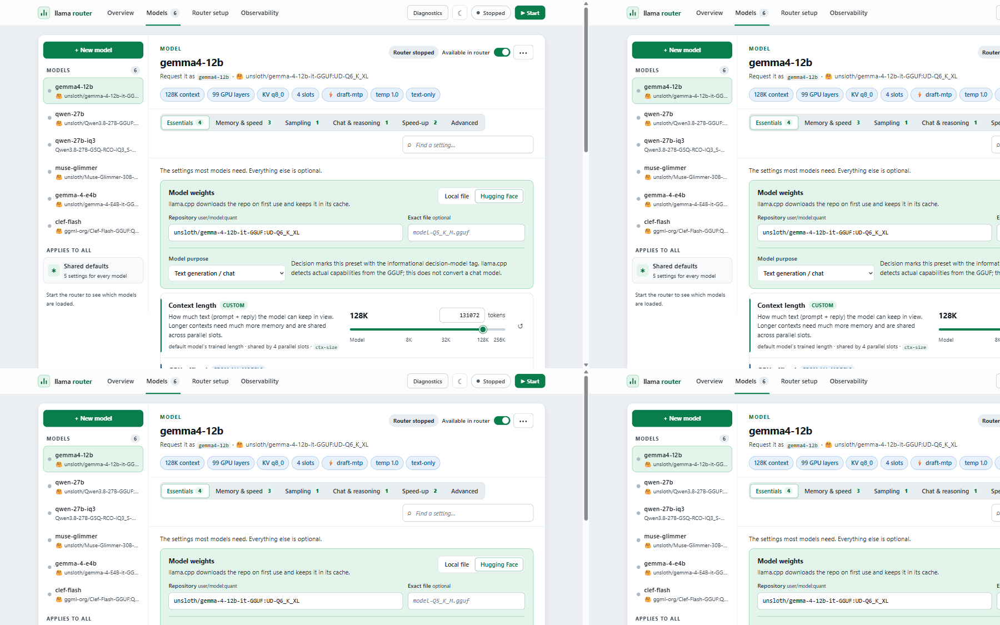
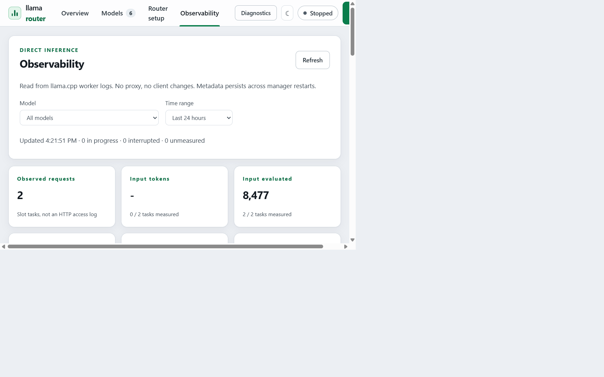

# llama.cpp Server Manager

<div align="center">

**A local dashboard for configuring, launching, hot-swapping, and observing
multiple GGUF models served by llama.cpp.**


</div>



## Why use it?

llama.cpp Server Manager gives a friendly browser UI to an **already installed
llama.cpp server** (`llama serve`, or the legacy `llama-server`). It keeps
model presets, router settings, process controls, diagnostics, and performance
metrics in one place without adding a proxy between your apps and llama.cpp.

- **Manage multiple models** with searchable controls instead of hand-editing
  long INI files.
- **Hot-swap GGUF models** through llama.cpp's native router and autoload
  behavior.
- **Use local files or Hugging Face repositories** as model sources.
- **See useful observability** for tokens, latency, cache reuse, throughput,
  and speculative decoding directly from llama.cpp logs.
- **Run locally and privately** on Windows or Linux with no Python packages,
  Node.js, Docker, cloud service, or telemetry.
- **Connect existing tools** to the standard OpenAI-compatible llama.cpp
  endpoint.

> [!IMPORTANT]
> This project manages an existing llama.cpp installation. It does not install
> llama.cpp or download model weights itself.

## Quick start

1. Install [Python 3.10+](https://www.python.org/downloads/) and a recent
   [llama.cpp](https://github.com/ggml-org/llama.cpp) build.
2. Download or clone this repository.
3. Launch the dashboard:

   **Windows**

   ```powershell
   .\launch-windows.cmd
   ```

   **Linux**

   ```bash
   chmod +x launch-linux.sh
   ./launch-linux.sh
   ```

4. Open **Models**, add a local GGUF file or Hugging Face repository, save the
   preset, and select **Start**.
5. Point your client at `http://127.0.0.1:8080/v1` and use the preset ID as the
   model name.

## What you get

| Area | Capabilities |
| --- | --- |
| Model catalog | Create, duplicate, rename, import, enable, and remove presets without deleting model weights |
| Guided settings | Context, GPU offload, KV cache, slots, sampling, chat, reasoning, speculative decoding, and advanced flags |
| Native routing | llama.cpp model presets, autoload, eviction, explicit load/unload, and live preset reloads |
| Observability | Request history, token counts, cache hit rate, prefill/generation speed, latency, and draft-token acceptance |
| Local operations | Process ownership, health checks, rotating diagnostics, light/dark themes, and persistent settings |
| Decision models | System One presets, Clef configuration, image support, and copyable request examples |



## Contents

- [Requirements](#requirements)
- [Launch options](#launch)
- [Configure models](#configure-models)
- [Start the router and connect clients](#start-the-router-and-connect-clients)
- [Observability](#observability-without-a-proxy)
- [Decision models (System One)](#decision-models-system-one)
- [Shutdown, persistence, and safety](#shutdown-persistence-and-safety)
- [Tests](#tests)

## Requirements

- Python 3.10 or newer; no Python packages, Node.js, Docker, or WSL required.
- A native llama.cpp build appropriate for your OS/GPU, with its required
  DLLs/shared libraries installed.
- A recent llama.cpp (`llama serve` or legacy `llama-server`) supporting
  `--models-preset`, `--models-max`,
  `--models-autoload`, `/models`, and `/models?reload=1`.
- Model files or existing INI presets with sources supported by your build.
  The manager does not install binaries or model weights.

## Launch

### Windows

Double-click **[launch-windows.cmd](launch-windows.cmd)**. It detects `py` or
`python`, starts the dashboard, and opens your default browser.
Startup failures remain visible in the terminal.

### Linux

Make **[launch-linux.sh](launch-linux.sh)** executable once, then run it:

```bash
chmod +x launch-linux.sh
./launch-linux.sh
```

Whether a file manager runs a clicked shell script depends on its settings;
running it in a terminal works independently of those settings.

### Manual launch and custom ports

```powershell
python app.py --open-browser
```

Use `python3` on Linux. The dashboard defaults to
**http://127.0.0.1:8787/**. For another dashboard port:

```powershell
.\launch-windows.cmd --port 8797
```

```bash
./launch-linux.sh --port 8797
```

`--data-dir PATH` selects another local settings/log directory.
`--open-browser` opens the default browser after the dashboard binds
successfully. If browser opening fails, the terminal shows the manual URL.
There is no `--api-port` option.

## Configure models

The dashboard has four views in the top bar: **Overview** (status, endpoint
and a tile per model with quick Load/Unload), **Models**, **Router setup**
and **Observability**. **Start**/**Stop** are always in the top bar.
**Diagnostics** opens the raw server output in a dialog, not a separate page.

1. In **Models**, click **+ New model**: give it an ID, choose *Local GGUF
   file* or *Hugging Face*, enter the path or repo, and optionally copy the
   settings of an existing model. To bring in an existing INI instead, use
   **Router setup → Import an existing models.ini** (replaces the managed
   list after confirmation; your original file is never changed).
2. Select a model in the sidebar. A summary strip shows its key settings
   (context, GPU offload, KV cache, slots, speed-up…); click one to jump to
   it. The **Essentials** tab holds the model weights plus the settings most
   models need, with purpose-built controls: a context-length slider, GPU
   offload modes (All / Auto-fit / CPU only / Layers), one KV-cache precision
   control (Full / Balanced / Compact) that sets K and V together, and more.
3. Other tabs (**Memory & speed**, **Sampling**, **Chat & reasoning**,
   **Speed-up**, **Advanced**) hold the rest. Every row explains the setting,
   shows llama.cpp's default, and is marked **Custom** (set on this model),
   **From all-models** (inherited from shared defaults) or left at default.
   **↺** resets a value. **Find a setting…** searches all tabs. Short flags,
   `no-` negations and `LLAMA_ARG_*` names (for example `c`, `no-mmproj`)
   are recognised and shown on the matching control.
4. **Shared defaults** (`[*]`) in the sidebar holds values for every model;
   a model's own value always wins.
5. **Advanced → Other llama.cpp flags** accepts anything without its own
   control (`name` + `value`, `true` for on/off flags). **Edit as INI text**
   edits the selected section as `key = value` lines:

   ```ini
   model = C:\models\your-model.gguf
   ctx-size = 8192
   n-gpu-layers = 99
   ```

   On Linux use the installed model's native path. All supported llama.cpp
   model options are passed through except manager-controlled networking,
   preset selection, aliases, and secrets. No interpolation is performed.
6. **Available in router** (model header) controls which models go into the
   generated INI; preview it under **Router setup**. The **•••** menu
   duplicates, renames or removes a model (removal never deletes weights).
7. **Router setup → Model switching** sets how many models stay in memory and
   whether models load on request. Capacity **1** with autoload lets the
   router evict the previous model when a client requests a different one.
   Stop the router to change these.
8. When you have edits, a bar appears at the bottom: **Save changes** (or
   **Ctrl+S**). Invalid values are flagged inline and block saving. If the
   router is running, **Apply to running router** reloads presets when
   clients are ready. llama.cpp may unload changed or removed models;
   unchanged models stay loaded. Failed reloads remain visibly pending.
Saving alone does not reload or disrupt the running router. Direct client
requests continue using the current configuration until Apply or the next
start. Unsaved browser edits are not persisted; Save before starting.

The model ID sent by clients is the INI section name. Optional top-level
`version = 1` is supported. `[*]` supplies shared defaults; `[DEFAULT]`,
duplicate keys/sections, and invalid options are rejected.

**Available in router is not an access-control allowlist.** Native llama.cpp may
enumerate cached models in addition to INI presets. This is a trusted
local-user tool, not a multi-user security boundary.

## Start the router and connect clients

By default the manager runs llama.cpp exactly as a terminal would. It looks
for the unified `llama` command first and launches it as `llama serve`; if
only the older `llama-server` exists, it runs that instead. It searches your
PATH (re-reading the saved Windows PATH, so fresh installs are found without
restarting the launcher), then common install locations (WindowsApps, winget,
scoop, Chocolatey, Homebrew, `/usr/local/bin`, `~/.local/bin`).
If llama.cpp isn't installed yet, `winget install llama.cpp` (Windows) or
`brew install llama.cpp` (macOS/Linux) is enough. **Router setup** shows which
binary was found and how it will run; choose **Custom path** only for a build
that isn't on PATH (a file named `llama`/`llama.exe` automatically gets
`serve`; paths are plain text without quotes; relative paths resolve from the
project directory). The router port defaults to **8080**. Click **Start** to
run that installed binary with the managed presets. The dashboard and router
ports must differ.

The dashboard uses a light theme by default; the ☾/☀ button in the top bar
switches to dark and remembers your choice.

The connection card shows the **router's own** OpenAI-compatible base URL:

```text
Base URL: http://127.0.0.1:8080/v1
API key:  not required (use "local" only if your client library requires a value)
Model:    your INI section ID
```

**Open llama.cpp web UI** opens the native router page. Client requests go
directly to llama.cpp, not through the manager. The manager does not proxy,
queue, authenticate, or pause those requests. It reads metadata from the
managed server's output for observability. Inference route support
depends on your installed llama.cpp build.

You do not need to load/unload models during normal use. The optional
**Load now**/**Unload** buttons (model header and Overview tiles) explicitly
load or unload a model when needed. The router handles normal hot swapping
on its own.

`starting` means the process is alive but `/health` is not ready yet. Check
**Diagnostics** for loading failures, incompatible options, missing libraries,
or insufficient memory.

## Observability without a proxy

**Observability** provides model and time-range filters (hour, day, week,
month, all time), metric cards, selectable trend plots, model comparisons,
and the latest 100 observed tasks. Click a model in the comparison table to
filter the entire dashboard. Collection runs even with the browser closed.
No client URLs, handshakes, request bodies or responses pass through the
manager.

The collector recognizes llama.cpp's slot/task timing lines, strips terminal
colors, and correlates router worker-port prefixes with model spawn/proxy
messages. Concurrent slots and worker restarts are kept separate. Unknown
models appear as **Unattributed** rather than being guessed. Metadata is
committed to `.local/observability.sqlite3` (SQLite WAL) and survives stopping
the router or manager. Existing raw logs are not replayed, so restarting
does not duplicate requests; collection begins with the next managed run.

- **Observed requests** counts slot tasks, not all HTTP requests. Requests
  with multiple completions may have multiple tasks. Rejected requests
  before slot assignment, embeddings without timing logs, and unlogged
  activity cannot be fully accounted for.
- **Input evaluated**, **output tokens**, prefill/generation speed and
  compute latency come from timing lines. Speed uses total measured tokens
  divided by total matching time, not an average of per-request speeds.
- **Input tokens**, **cached input tokens** and **cache hit rate** require
  prompt-length lines (`new prompt … task.n_tokens`, or older `prompt done
  … n_tokens`). Cached input is full input minus evaluated input. Truncated
  or inconsistent prompt counts are excluded. Cache hit rate is the
  token-weighted cached fraction of known input, not the fraction of
  requests with any cache reuse.
- **Draft tokens** and **draft acceptance** come from the explicit
  accepted/generated summary. No draft summary means unavailable, not zero.
- **Client time to first token** is unavailable from ordinary timing logs.
  Prefill latency is shown separately and is **not TTFT**; it excludes router
  queuing, model loading and network delivery. Exact client TTFT requires
  client instrumentation; the manager does not introduce a measurement proxy.
- Cards report measurement coverage. Missing values display **-**,
  not invented zeros. A **measured** history entry means timing capture
  completed, not that HTTP delivery necessarily succeeded. Interrupted or
  unmeasured tasks remain in history.

Log formats and verbosity vary between builds. Normal info logs in recent
builds include timing/draft summaries but may omit prompt-length/cache
details. The manager does not increase verbosity or change server launch
flags automatically. More verbose logs may expose prompts in raw
diagnostics; enable them only after checking your build's behavior.
The observability database stores only identifiers, timestamps, statuses,
counts and timings, never prompt or generated content. Raw rotating logs
are separate and may contain sensitive content emitted by llama.cpp.
Metric parse failures and storage errors are surfaced in the dashboard.

## Decision models (System One)

Native decision GGUFs, including
[Clef-Flash](https://huggingface.co/ggml-org/Clef-Flash-GGUF), use the same
router presets and load/unload controls as text models. In **New model**,
choose **Decision model (System One)** and a GGUF path or Hugging Face repo.
For an existing model, change **Essentials → Model purpose**.

Purpose is stored as the standard informational `tags = decision-model`
in the preset, so import/export, duplication and renaming preserve it.
This enables the **Decisions** tab and appropriate Essentials controls.
Tags do not convert an LLM into a decision model. Actual capability comes
from the GGUF. When a recent router advertises
`architecture.output_modalities` containing `decisions`, the manager also
recognizes it automatically, including unloaded models. Older servers may
omit that metadata; the explicit preset tag remains usable.

The **Decisions** tab includes context, logical/physical batch limits,
parallel slots, vision projector and image-token budgets, along with a
copyable endpoint and JSON request example. Sampling, chat and speculative
controls remain accessible for inspecting existing presets, but they do
not drive Clef's probability outputs.

**Clef evaluates its entire prompt in one physical batch**, including
state, question/schema and image tokens. A blank decision preset starts
with **4096** context, logical batch and physical batch sizes, **one slot**,
**f16 KV**, **automatic vision projector**, and **no speculative decoding**. Increase context and both
batch sizes together for longer requests; this needs more memory.
**Use 4K decision starter** applies those settings after confirmation.
Other decision architectures may have different batch limits. No
embedding, pooling, reranking or decision-mode flag is required.

Example preset:

```ini
[clef-flash]
hf-repo = ggml-org/Clef-Flash-GGUF:Q4_K_M
tags = decision-model
ctx-size = 4096
batch-size = 4096
ubatch-size = 4096
parallel = 1
cache-type-k = f16
cache-type-v = f16
mmproj-auto = true
spec-type = none
```

For Clef image input, keep the automatic projector on for a Hugging Face
source, or provide a local `mmproj` file alongside local weights.
Text-only decisions do not require a projector. Supply image data URLs
in `images`; the model must support images and have its projector loaded.

Send requests **directly to llama.cpp**, not the manager:
`POST http://127.0.0.1:8080/v1/systemone`, with `Content-Type: application/json`.

```json
{
  "model": "clef-flash",
  "state": "Customer message: I was charged twice.",
  "questions": {
    "route": {
      "type": "choice",
      "instructions": "Which team should handle this?",
      "criteria": {"billing": "Charges and refunds", "technical": "Bugs and errors"}
    }
  }
}
```

Question types are `choice` (option probabilities), `score` (expected level
from 2–10 ordered levels) and `noul` (yes probability). Clef evaluates its
questions jointly. It serves `/v1/systemone`, not chat completions, and
does not support streaming. The API reports `usage.output_tokens = 0`.
Log-only observability may leave generation/draft statistics missing (`-`)
because no text is generated; it cannot infer question counts from HTTP
request bodies it never sees.

Use a recent llama.cpp build with System One and Clef support
([PR #29831](https://github.com/ggml-org/llama.cpp/pull/29831)).
The manager does not upgrade your binary or participate in client handshakes.
See the [decision-model introduction](https://huggingface.co/blog/ggml-org/decision-models-in-llamacpp)
and [System One API reference](https://github.com/ggml-org/llama.cpp/blob/master/tools/server/README.md#post-v1systemone-typesafe-compatible-system-one-api).

## Shutdown, persistence, and safety

- **Stop** stops only the process started by this manager and its owned
  router workers. **Ctrl+C** in the launcher terminal stops both the dashboard
  and its managed process. Closing the browser tab stops neither.
- The manager does not adopt, stop, or modify an independently running server.
  If the desired port is occupied, stop that server yourself or choose another
  port. It launches your existing binary; it does not install a new server.
- Windows router workers use a kill-on-close Job Object. Linux router workers
  use a separate process session. Ownership failures abort startup.
- The dashboard and router bind to `127.0.0.1`. The router has no API key.
  Dashboard Host/Origin checks and automatic per-session CSRF tokens remain
  to prevent cross-site process/configuration changes. Do not expose either
  service through tunnels, proxies, or port forwarding.
- Settings persist in `.local/config.json`, `.local/workspace.json`, and
  `.local/catalog.json`; generated presets are `.local/router-active.ini`.
  Logs are `.local/llama-server.log`, rotating at 2 MiB with two backups.
  Diagnostics shows the latest 500 lines and fetches them only while its
  dialog is open. The visible observability dashboard refreshes every two
  seconds; collection is independent of UI polling.
- Only one dashboard may use a data directory at a time. If another launcher
  is running, stop it before launching again.
- Original INI and weight files are never overwritten or deleted. Existing
  statistics/token files from earlier versions are not needed by clients;
  legacy data is not automatically deleted.
- Keep `.local` private, out of version control, and back it up with the
  manager stopped. Invalid settings are reported explicitly, not discarded.

## Tests

```powershell
python -m unittest discover -s tests -v
```

Use `python3` on Linux. Tests use a fake native server and temporary fixtures
to verify model editing, INI persistence, direct router requests/hot swapping,
reloads, startup/shutdown, ownership, direct-log observability, durable
metadata, filters, parser coverage, and dashboard routes. Legacy accounting
helpers also retain their regression tests but are not started as a client
service. Real model/build compatibility is determined by your installed
llama.cpp.

Optional JavaScript control tests use Node's built-in runner (Node is not
needed to run the manager):

```powershell
node --test tests\test_decision.js
```

## Disclaimer

This code was AI-generated using GitHub Copilot. Review and test it for your
own environment and use case before relying on it.
